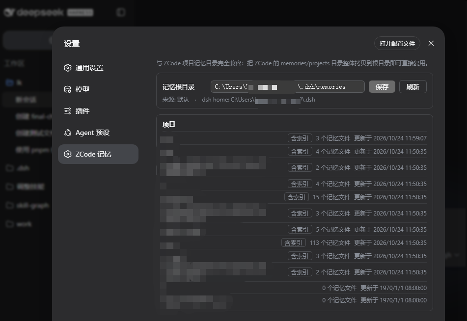

# dsh-zcode-memory

ZCode-compatible project memory, a post-turn changed-files panel with review/open actions, and a memory settings page for DeepSeek Harness (dsh).

[中文说明](README.zh.md)

**Compatibility: dsh `>=0.2.1-rc.3 <0.3.0-0`** (plugin v0.2.0; declared via `engines.dsh` and verified against `0.2.1-rc.3`). The installer refuses to run against an incompatible dsh. For dsh 0.1.x use plugin [v0.1.0](https://github.com/gniquil123/dsh-zcode-memory/releases/tag/v0.1.0).

## Features

1. **ZCode-compatible project memory** — per-project memory directories whose names follow the exact same encoding rule as ZCode (`basename slug` + `-` + first 16 hex of SHA-256 over the normalized absolute path, lowercased on Windows). Copy ZCode's `memories/projects/` tree into this plugin's memory root and every project resolves to the same directories, ready to reuse and maintain. Each agent session receives one context injection teaching the model the memory protocol (four memory types, frontmatter format, `MEMORY.md` index rules) plus the project's current index; writes inside the memory root are sandbox-auto-allowed, mirroring ZCode's memory file permission.
2. **Post-turn changed files** — on dsh 0.1.x, plugin v0.1.0 rendered a turn-tail panel with a **Review** button (inline +/- diff) and an **Open** button. On dsh 0.2.x the official `dsh-workspace-changes` + deliverables UI provides this natively (turn tail with per-file diff and open actions), so this plugin no longer ships its own panel and defers to it.
3. **Settings page** — a dedicated "ZCode Memory" section in the web settings: view/edit the memory root (persisted), and browse per-project memory statistics (file count, index presence, total size, last modified) down to single-file previews (5 MiB cap, same as ZCode).



> Fully compatible with ZCode project memory directories: copy ZCode's `memories/projects` tree into the memory root and it is reused as-is.

## Install

Prerequisites: [Node.js](https://nodejs.org) ≥ 20 with npm (`dsh` and `pnpm` are located automatically — no PATH setup needed).

### From the release archive (one line)

```sh
tar -xzf dsh-zcode-memory-0.1.0.tgz && node dsh-zcode-memory/install.mjs
```

`install.mjs` registers the plugin into the `web` profile via the official `dsh plugin add` flow and links every peer dependency to the running dsh installation, so the plugin and the host share one module instance. Options: `--profile <name>` (default `web`), `--home <dsh-home>` (default `$DSH_HOME` or `~/.dsh`), `--dsh <dir>` (override auto-detection).

### From a git clone

```sh
git clone https://github.com/gniquil123/dsh-zcode-memory.git
node dsh-zcode-memory/install.mjs
```

### Desktop app profile

The `desktop` profile is managed exclusively by the Electron app — the CLI refuses `dsh plugin add` there. Install manually (same pattern as any third-party desktop bundle):

1. Edit `~/.dsh/profiles/desktop/package.json`: add `"dsh-zcode-memory": "link:<path-to-clone>"` to `dependencies` and `"dsh-zcode-memory"` to `dsh.profile.bundles`.
2. Run `pnpm install` in that directory.
3. Restart the DeepSeek Harness desktop app.

Then restart the profile: `dsh web`. The settings page gains a "ZCode Memory" section.

## Migrate existing ZCode memories

```sh
# Windows (PowerShell)
Copy-Item -Recurse "$env:USERPROFILE\.zcode\cli\memories\projects" "$env:USERPROFILE\.dsh\memories\projects"
```

```sh
# macOS / Linux
cp -r ~/.zcode/cli/memories/projects ~/.dsh/memories/projects
```

Memory root defaults to `<dsh-home>/memories`; projects live at `<root>/projects/<project-key>/memory/`. Keys are computed exactly like ZCode's, so the copy is recognized as-is.

## Configuration

Edit the profile's user patch layer (`~/.dsh/profiles/web/cordis.patch.yml`):

```yaml
- id: zcode-memory
  config:
    enabled: true            # false disables injection and the remote service
    memoryRoot: ""           # non-empty overrides the root (wins over the settings page value)
    memoryWriteAllow: true   # widen the sandbox to danger-full-access for writes inside the memory root only
```

Runtime changes made on the settings page persist to `<dsh-home>/dsh-zcode-memory.json`; a patch-configured `memoryRoot` always wins.

## Security notes

- `memoryWriteAllow` widens the sandbox policy **only** for `writeText`/`editText` calls whose resolved target lies inside the memory root — the equivalent of ZCode's auto-allowed memory writes. Bash and all other paths keep the session's standing mode. Set it to `false` if you prefer approving memory writes manually.
- Injected memory content is model-readable context, exactly like ZCode: memory files are written by the model, and consumers must verify freshness before recommending from them (the injected protocol includes that instruction).

## Known issues

- `$DSH_HOME/.credentials.yaml` written by a newer dsh desktop build uses a rich format that `0.1.0-rc.6`'s flat parser rejects. If you run both, point the web profile's `credentials` row at a separate file via the user patch layer:

  ```yaml
  - id: credentials
    config:
      path: '<dsh-home>/.credentials-web.yaml'
      dshHome: '<dsh-home>'
  ```

## Implementation notes

- Host half (`lib/index.js`): injects the memory context once per session on `agent/pre-step` (mid-session re-injection would wake the agent loop into a spurious reply); wraps `ctx.fs.writeText/editText` for the memory-root allowance; registers a Typert Remote gateway.
- Remote channel: `lib/typert.host.js` is a hand-written generator-format Typert contract (`dsh-typert-loader` auto-registers any mounted package's `./typert` export); the client half mounts its descriptors through the public `ctx.remote.$mount`. Self-mounted namespaces must NOT be declared in the module's `inject` (that deadlocks the boot waiting on a service only the module itself creates) — calls resolve through `remote.namespaces`.
- Changed-files: pure client-side derivation over the conversation event stream, following the official deliverables plugin's accumulator pattern. The turn tail is a chain slot electing the first non-null selector in ascending `priority`; this panel registers at `priority: -1` so it wins when diffs were captured and defers to the official produced-files panel otherwise.
- `lib/project-key.js` is ported 1:1 from ZCode (`zai-org/ZCode`, `apps/zcode-cli/packages/core/src/memory/project-root.ts`, Apache-2.0, marked changed); prompts are adapted from ZCode's provider-visible memory prompts. See `LICENSE` for third-party notices.
- Plain JS, no build step; `lib/client.js` is hand-rolled in dsh ModuleLoader's lazy-CJS factory format.

## Changelog

### v0.2.0 (2026-10-26)

- **Support dsh 0.2.1-rc.3** — compatibility moved to `>=0.2.1-rc.3 <0.3.0-0`; the typert contract was rewritten for the new `createTypertRemoteInfo` + lazy `create()` zod-factory format (the old `schema` field fails at boot on 0.2.x).
- **Installer version gate** — the installer reads the installed dsh version and refuses to install when it does not satisfy `engines.dsh` (dependency-free semver range evaluation); dsh CLI's own plugin gate acts as a second layer.
- **Changed-files panel handed to the official UI** — dsh 0.2.x ships `dsh-workspace-changes` + the new deliverables surface (turn tail with per-file diff and open actions) natively, so this plugin no longer carries its own 0.1-era client accumulator.
- **Desktop profile install documented** — the `desktop` profile is managed exclusively by the Electron app; see the install section for the manual manifest + pnpm steps.
- Verified against dsh 0.2.1-rc.3: plugin v0.2.0 active, the ZCode Memory settings section renders, and the remote gateway round-trips (11 ZCode-migrated projects listed).

### v0.1.0 (2026-10-24)

- Initial release for dsh 0.1.0-rc.6: ZCode-compatible project memory, client-side post-turn changed-files panel with review/open, memory settings page.

## License

[MIT](LICENSE)
